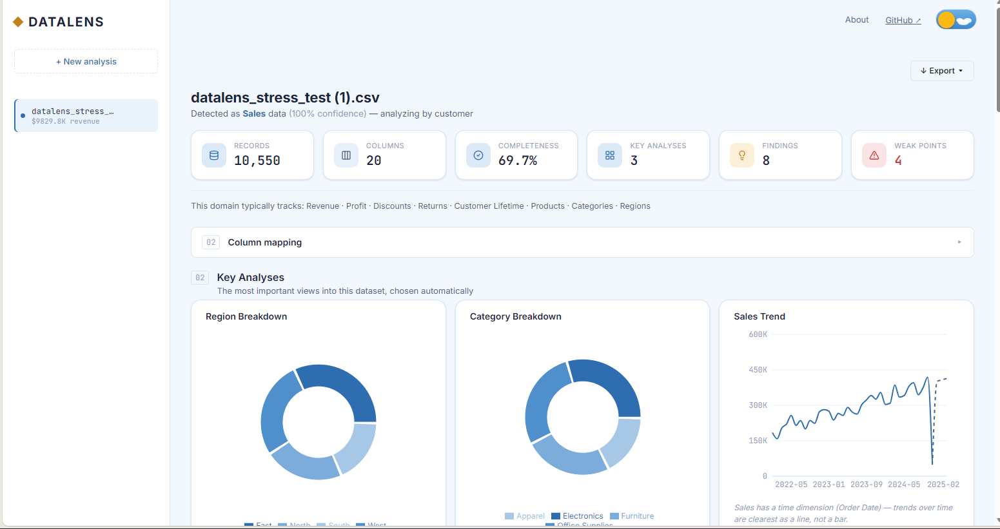
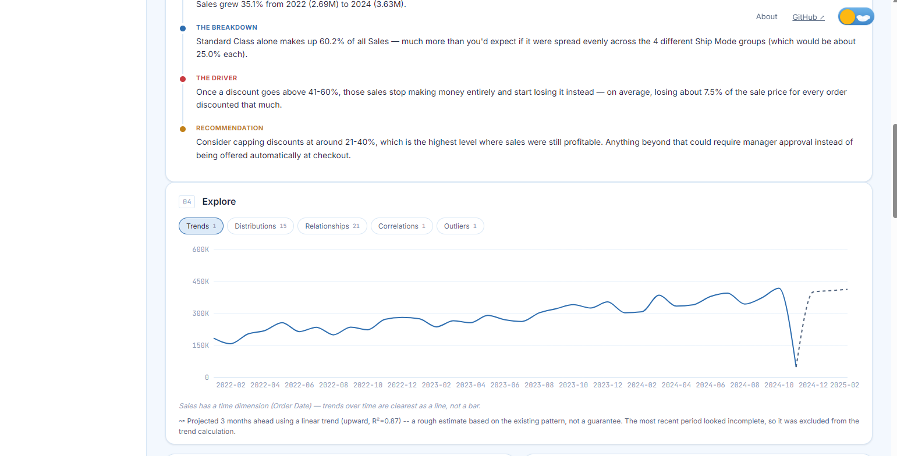
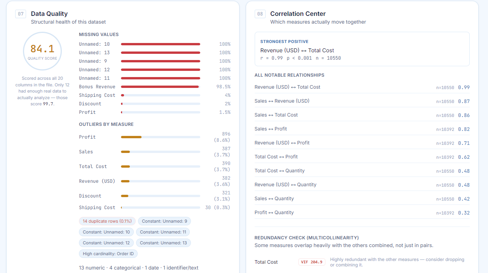
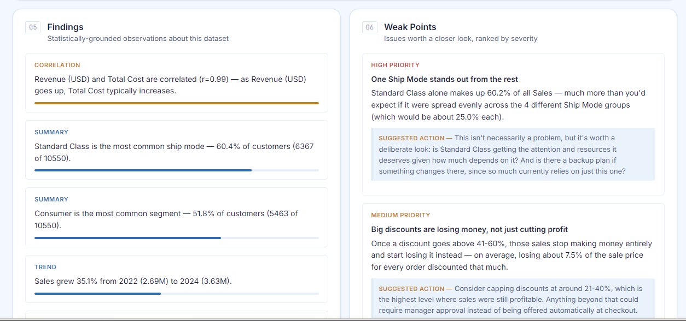
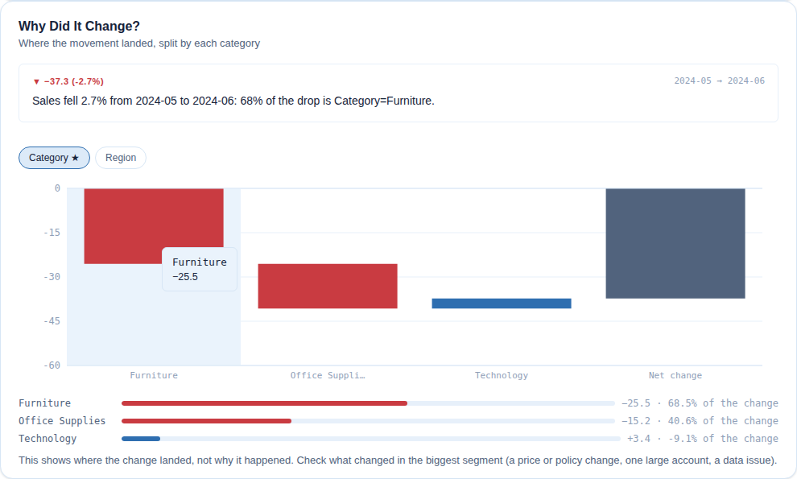
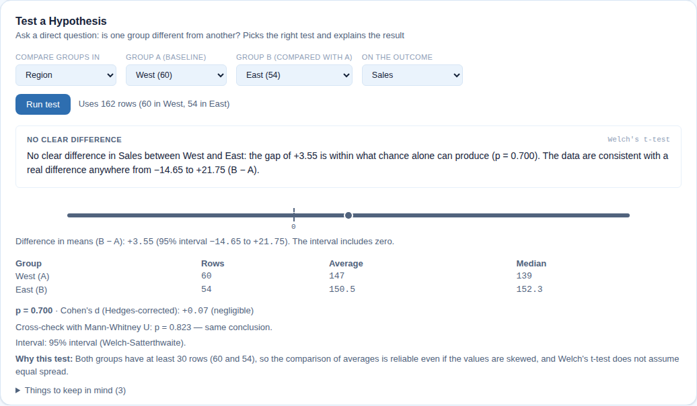
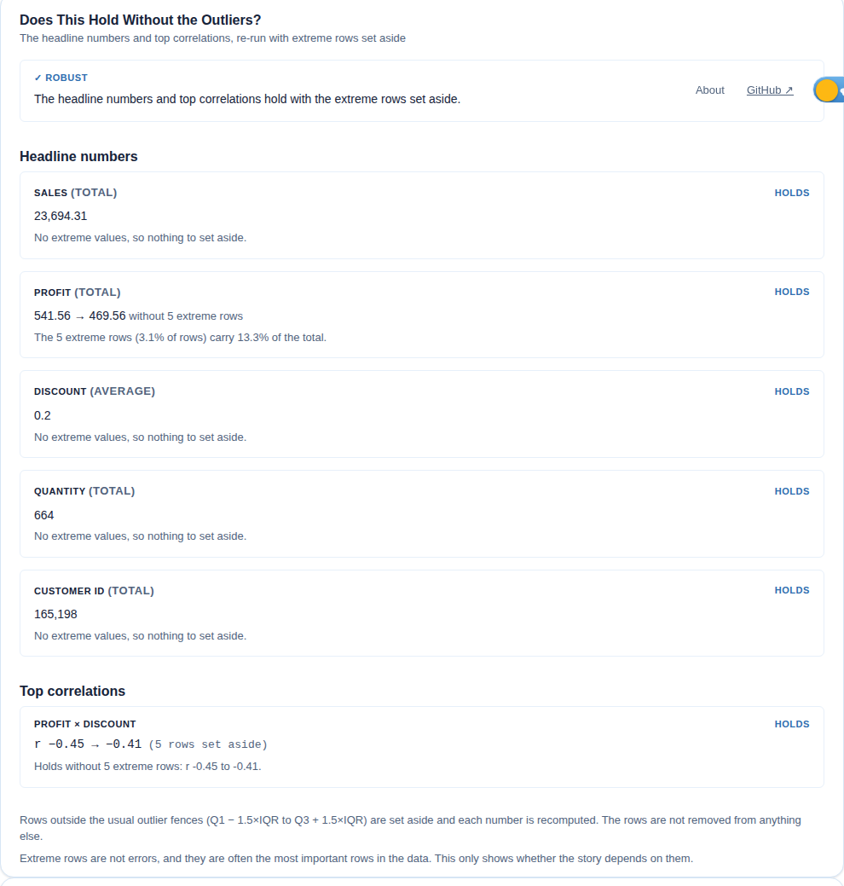
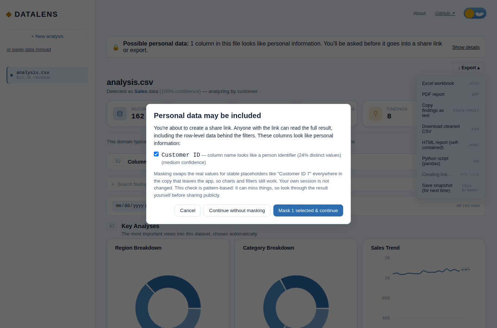

# DataLens — Universal Data Intelligence

Upload any structured dataset — CSV, TSV, or Excel — and get back a full
analytical report in seconds: automatic domain detection, the 3 most
valuable analyses for that specific dataset, a plain-English narrative
story, statistically-validated correlations, and concrete, prioritized
recommendations. Not a generic BI dashboard — the analysis itself adapts
to whether it's looking at healthcare, sales, retail, manufacturing,
marketing, education, HR, traffic, or finance data.

**[Live demo →](#)** &nbsp;·&nbsp; *(add your Render URL here before sharing this repo)*

---

## Screenshots

**Upload → instant domain-aware dashboard.** Detected as Sales data at
100% confidence, with the three most relevant charts chosen automatically
for this specific dataset.



**A narrative that reads like an analyst wrote it, plus linear trend
forecasting** — the dashed line projects forward, and the caveat
underneath explains exactly how (and how confidently), including
automatically excluding an incomplete final month from the projection.



**Statistical rigor, not just charts.** Every correlation carries a
p-value and sample size, and measures are checked for multicollinearity
(VIF) so redundant metrics don't get mistaken for independent signals.



**Findings ranked by what's actually worth knowing**, plus concrete,
prioritized recommendations — not just "here's a chart," but "here's what
to do about it."



### Trust, depth and engineering quality

**"Why did it change?"** The movement split by category as a waterfall
that adds up exactly to the net change. It says where the change landed,
and states plainly that it can't say why.



**Test a Hypothesis.** The test is chosen and justified, the verdict leads
with the effect and the interval rather than the p-value, and the interval
graphic always shows zero so "no clear difference" is visible at a glance.



**Does this hold without the outliers?** Resampling can't see a result
that is really about a handful of extreme rows; this can.



**Personal-data guard.** Sharing stops and asks first. Masking swaps real
values for stable placeholders in a copy of the result, so charts and
filters still work. Legible in both themes (a contrast test enforces it).



---

## Why this project is interesting

Most portfolio dashboards plot whatever columns exist. DataLens tries to
behave the way an actual analyst would: it figures out *what kind* of
dataset it's looking at, decides what's worth analyzing for that domain
specifically, and flags when a finding shouldn't be trusted.

- **Domain-aware, not one-size-fits-all.** Every uploaded file is scored
  against 9 domain profiles (healthcare, sales, retail, manufacturing,
  marketing, education, HR, traffic, finance) based on which semantic
  column roles are present, and the entire analysis — which KPIs matter,
  which charts get generated, what "weak points" even means — adapts to
  the result.
- **Statistically honest.** Every correlation is reported with its actual
  p-value and sample size, not just the coefficient. A strong-looking
  relationship on 12 rows gets flagged as unreliable instead of presented
  as a confident finding. Measures are also checked for multicollinearity
  (VIF) so redundant metrics don't get treated as independent signals.
- **100% rule-based — no LLM calls.** Every finding, story beat, and
  recommendation comes from an explicit, auditable scoring engine. This
  was a deliberate constraint: it keeps the tool free to run, safe to
  deploy publicly with no per-user API cost, and every output is
  traceable back to the exact rule that produced it.
- **Extensible by design.** Adding a new domain is one small analyzer
  file plus one registry line — the plugin architecture means domain
  logic never leaks into the shared pipeline.
- **Built to be checked, not just trusted.** The newer features are
  verified the hard way: the exported pandas script is *executed* and its
  numbers compared to the dashboard's, the hypothesis tests are
  calibration-tested (about 5% false positives when nothing is going on),
  and a real browser checks that masked share links really contain no
  personal data. See [`docs/CASE_STUDY.md`](docs/CASE_STUDY.md) for what
  that testing caught.

## Features

- Automatic semantic column detection (works on files it's never seen —
  no fixed schema)
- Domain detection across 9 verticals with a confidence score
- Auto-generated dashboard: the 3 most important analyses, picked and
  chart-typed automatically, with reasoning for each choice
- Narrative "Story" mode — findings chained into a Trend → Breakdown →
  Driver → Recommendation arc
- Ranked findings and weak-point detection (plain-English, no jargon)
- Data quality report: missing values, duplicates, constant columns,
  outliers, overall quality score
- Correlation Center with significance testing (p-values, sample-size
  caveats) and multicollinearity (VIF) detection
- Linear trend forecasting on time-series measures, with a confidence
  check so it stays silent rather than guessing on noisy data
- Interactive filtering — date range and per-dimension filters that
  live-update the trend and breakdown charts client-side, no re-upload
- Global search across findings, charts, weak points, story, and
  correlations, with click-to-jump navigation
- One-click Excel or PDF export of the full report
- Multi-file sessions with pinning and dataset combining
- **"Why did it change?"** — splits any move (latest month, or a detected
  break) by each category, so "sales fell 2.7%" becomes "68% of the drop
  is Category=Furniture". Plain groupby arithmetic; the pieces add up
  exactly to the total, and offsetting moves are called out instead of
  producing silly percentages
- **Personal-data detection and a share/export guard** — scans for emails,
  phone numbers, card numbers, government IDs and person identifiers, and
  stops a share link, HTML or PDF export to offer masking. Share links are
  also enforced **on the server**: it re-checks the payload itself, so a
  script that skips the dialog is refused too
- **Robustness check** — re-runs the headline numbers and top correlations
  with extreme rows set aside, and flags what moves materially or flips
  (a different failure mode from sampling noise)
- **Test a Hypothesis (A/B mode)** — pick a group column, two groups and an
  outcome; it chooses Welch's t, Mann-Whitney, chi-square or Fisher's exact,
  and answers with an effect size, an interval and a plain-language verdict
- **Show the code** — exports a pandas script that reproduces the loading,
  cleaning, headline numbers, the groupby behind each analysis and the
  active filters; template-based, no LLM

## Tech stack

| Layer | Choice |
|---|---|
| Backend | Python, FastAPI, pandas, NumPy, SciPy |
| Frontend | React 19, Vite, Recharts, lucide-react |
| Export | SheetJS (client-side .xlsx generation) |
| Deployment | Render (single process serves both API and built frontend) |
| Data & auth | None — everything is processed in memory per request and discarded |

---

## First-time setup (Windows)

Just **double-click `start.bat`**.

The first time you run it, it will:
1. Create a Python virtual environment (`venv`)
2. Install everything in `requirements.txt`
3. Launch the server and open your browser automatically at `http://127.0.0.1:8000`

Every time after that, double-clicking `start.bat` just launches it directly
(skips the setup since `venv` already exists) and opens your browser
automatically — no typing, no manual URLs.

## Manual setup (if you'd rather run it yourself)

```powershell
python -m venv venv
venv\Scripts\activate
pip install -r requirements.txt
python run.py
```

## Supported file formats
`.csv`, `.tsv`, `.xlsx`, `.xls` — column roles (date, revenue, profit,
category, region, customer, etc.) are auto-detected from the header names or
inferred from the data if the names don't match anything known.

## Project structure

```
Data_Lens/
  app/
    main.py                 — FastAPI app: serves both the API and the frontend
    understanding.py        — produces the DatasetProfile every downstream step consumes
    semantic_roles.py       — classifies each column into a semantic role
    domains.py               — scores which domain (healthcare/sales/etc.) the data belongs to
    analyzers/               — one plugin per domain (registry.py maps domain -> analyzer)
    analysis_planner.py      — decides which analyses to run and picks chart types
    executor_v2.py           — computes chart data for each planned analysis
    insight_engine.py        — positive findings
    weak_points.py           — problems, impact, priority, suggested action
    story_engine.py          — narrative arc over findings/weak points
    data_quality.py          — missing values, duplicates, outliers, quality score
    correlation_center.py    — correlation significance testing + multicollinearity (VIF)
    drivers.py               — "Why did it change?": splits a change by each dimension
    robustness.py            — re-runs headline numbers/correlations without extreme rows
    sensitive_data.py        — personal-data detection (column names and kinds, never values)
    hypothesis.py            — A/B mode: test selection, effect size, interval, verdict
    code_export.py           — template-based pandas script that reproduces the analysis
    kpi.py, insights.py, column_detector.py, planner.py, executor.py
                              — original sales-specific pipeline, kept running
                                alongside the domain-aware one (legacy fields in the API response)
    static/                   — the BUILT frontend (do not hand-edit — see below)
  frontend/                   — frontend SOURCE CODE (edit here, then rebuild)
  requirements.txt
  run.py                      — launches the server + opens your browser
  start.bat                   — Windows one-click launcher
```

## If you want to change the frontend design or behavior

Edit files under `frontend/src/`, then rebuild and re-copy into the
backend's static folder:

```powershell
cd frontend
npm install      # first time only
npm run build
cd ..
Remove-Item -Recurse -Force app\static
Copy-Item -Recurse frontend\dist app\static
```

Then just run `start.bat` (or `python run.py`) again — the server will pick
up the newly built files automatically since it serves whatever is in
`app/static`.

For active frontend development with hot-reload instead of rebuilding every
time, run the backend (`python run.py`) and, separately, `npm run dev`
inside `frontend/` — set `VITE_API_BASE=http://127.0.0.1:8000` in a
`frontend/.env` file so the dev server talks to your backend on a different
port.

## Deploying (Render)

`render.yaml` already describes the service. What it sets, and why:

| Setting | Value | Why |
|---|---|---|
| `healthCheckPath` | `/api/health` | Render restarts the service if it stops answering and waits for it before switching traffic |
| `PYTHON_VERSION` | `3.12.7` | the minor version CI tests on, instead of whatever Render defaults to |
| `DATALENS_MAX_FILE_MB` | `10` | the app's own default (250 MB) suits your own machine, not a 512 MB host (below) |

**Why the upload cap is 10 MB on the free plan.** Measured on this app (single process, 9-column
sales-style CSV): it uses about 200 MB just to start, and peaks at roughly

| Upload | Peak memory |
|---|---|
| 600 rows | 246 MB |
| 50,000 rows (3 MB) | 355 MB |
| 200,000 rows (13 MB) | 397 MB |
| 500,000 rows (32 MB) | **619 MB** (over a 512 MB instance, which is killed and restarts) |

The cap is enforced while the file is being read, so an oversized upload is refused without being
loaded into memory first. On a larger plan, raise `DATALENS_MAX_FILE_MB`; wider files use more memory per MB,
so measure your own.

**What to expect on the free plan.**
- An idle service is spun down (after about 15 minutes) and the next visit waits roughly a minute for it to start.
- Share links are held in the server's memory for 24 hours, so a spin-down, restart or redeploy ends them.
  This is by design (no database; see `app/share_cache.py`), and worth knowing before sending a link to someone.
- There is no login and no rate limiting: anyone with the address can upload. Nothing is stored beyond share
  links, but the server does the work for every request.

**Before you deploy, refresh the frontend.** `npm run build` writes to `frontend/dist`; the server serves
`app/static`, which is refreshed by the copy step in the section above. Forgetting it deploys the new
backend with the old frontend.

**Check a deployment.** This runs against the live address; it builds and starts nothing, waits for a sleeping
instance to wake, and changes nothing except one tiny share link that expires in 24 hours:

```powershell
$env:LIVE_URL = "https://your-app.onrender.com"
cd frontend
npm run test:live
```

It checks that the deployed frontend is the current build (and tells you the exact commands if it is
stale), that the upload cap is set to a safe value, and that the main features work against the real server,
including that the share API refuses personal data.

## Notes
- Nothing is persisted or sent anywhere beyond your own machine — each
  upload is processed in memory and discarded after the response is sent
  (the one exception is a share link, which a deployed server keeps in memory for 24 hours).
- If you ever move or rename this folder, delete `venv` and let `start.bat`
  recreate it — virtual environments hard-code absolute paths and break if
  the folder moves.

## Roadmap
- More domains (Retail, Manufacturing, Agriculture, Sports, Marketing,
  Customer Support)
- Interactive filtering (date/region/category filters live-updating charts)
- Global search across charts/insights/findings
- Trend forecasting on time-series measures
- PDF export
- Auth + persistence — an open product decision, not a default: this app
  is currently pitched as "nothing is stored," and adding accounts
  reverses that. See `HANDOFF.md` for the full reasoning.


## Testing

Three layers, from fast to realistic. All run in CI (`.github/workflows/ci.yml`).

| Layer | Command | What it covers |
|-------|---------|----------------|
| Backend (pytest) — 335 tests | `python -m pytest tests/` | the analysis pipeline, API endpoints, statistics, and a **contract test** that fails if `/api/analyze` drops or retypes a field the frontend relies on |
| Frontend (Vitest) — 407 tests | `cd frontend && npm test` | pure logic (filtering, query builder, snapshots, masking, API client), every panel rendered in jsdom, the whole `<App />` driven from a *real* captured backend response, and a source scan that fails on JS unicode escapes written in JSX text (they render literally and build clean) |
| End to end (Playwright) — 11 tests | `cd frontend && npm run test:e2e` | a real browser against the real server: upload, dashboard, query builder, Present, navigation; the hypothesis test; **downloading the exported Python script and running it**; the personal-data guard, including that a masked share request contains no real customer ids, and that the share API itself refuses personal data from a caller that skips the UI; the driver and robustness panels; and a WCAG contrast check of the warning in both themes. Any uncaught exception or console error fails a test |

A few tests are worth singling out because they check the *answer*, not just that code runs:

- **Round trip:** the generated pandas script is executed on the sample datasets and every analysis and headline number is compared to what the dashboard computed.
- **Calibration:** with no real difference between groups, about 5% of 600 simulated hypothesis tests must come out significant; with a real effect, over 90% must, and none may point the wrong way. A miswired p-value fails this even when every unit test passes.
- **Mutation-checked guards:** the share enforcement and the contrast check were each verified by switching the protection off and confirming the tests fail.
- **Independent cross-checks:** the Welch interval equals SciPy's exactly, and the Newcombe interval is rebuilt from SciPy's own Wilson intervals.

First run of the browser test: `cd frontend && npx playwright install chromium`.
If you can't download browsers, point `PLAYWRIGHT_CHROMIUM_EXECUTABLE` at any Chromium/Chrome binary.
The exported-script test needs `python` (or `python3`, or `$PYTHON`) on the PATH.

After an intentional change to the API response shape, refresh the captured fixture:
`python scripts/regenerate_frontend_fixture.py`, then re-run `npm test`.

To regenerate the screenshots in this README from the running app:
`cd frontend && DATALENS_SCREENSHOTS=1 npx playwright test e2e/screenshots.spec.js`
(skipped otherwise, so CI never runs it).
